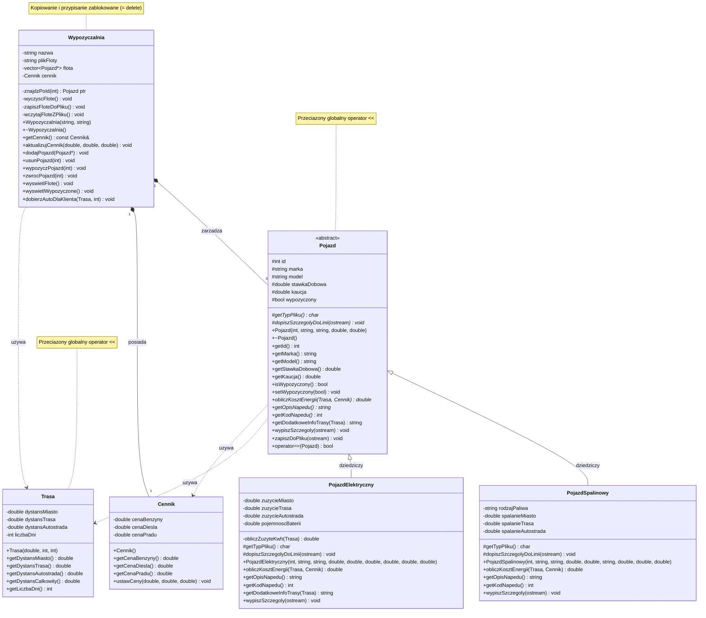

# System Obsługi Wypożyczalni Samochodów - Wypożyczalnia ABC

Konsolowa aplikacja wspomagająca pracę pracownika wypożyczalni samochodów. Program zarządza bazą pojazdów zapisaną w pliku tekstowym i wylicza najbardziej opłacalną ofertę wynajmu na podstawie planowanej trasy klienta.


## Funkcjonalności programu

1. **Podgląd stanu floty** - wyświetla wszystkie pojazdy wraz z ich ID, napędem, stawką dobową, kaucją zwrotną, statusem dostępności oraz parametrami zużycia paliwa lub energii.
2. **Dobór najtańszego auta dla klienta** - filtruje dostępne pojazdy według preferencji napędu (wszystkie, spalinowe, elektryczne), oblicza łączny koszt najmu oraz paliwa/prądu dla wybranego profilu trasy (miejska, ogólna, międzymiastowa) i wskazuje najtańszą ofertę.
3. **Symulacja ładowania aut elektrycznych** - sprawdza, czy energia z baterii wystarczy na całą trasę, a w razie przekroczenia zasięgu wylicza liczbę postojów na ładowarce oraz szacowany czas ładowania.
4. **Wydawanie i przyjmowanie zwrotów** - zmiana statusu pojazdu po jego numerze ID (podczas przyjmowania zwrotu program wyświetla wyłącznie listę aktualnie wypożyczonych aut).
5. **Dodawanie i usuwanie pojazdów** - rozbudowa floty o nowe auta oraz usuwanie dostępnych pojazdów z bazy.
6. **Aktualizacja cennika** - zmiana stawek za litr benzyny, diesla oraz 1 kWh energii elektrycznej w trakcie działania programu (domyślnie: Benzyna 6.50 PLN, Diesel 6.65 PLN, Prąd 2.50 PLN).


## Zasady korzystania z programu

* **Brak spacji w nazwach pojazdów:** Podczas dodawania nowego auta markę należy wpisać jako jedno słowo, a w modelu zamiast spacji używać znaku podkreślenia `_` (np. `Corolla_1.5_VVT_2022`, `ES_300h_Hybryda_2023`). Wynika to ze sposobu zapisu kolumn w pliku tekstowym.
* **Plik bazy danych (`flota.txt`):** Musi znajdować się w tym samym folderze co plik wykonywalny programu. Każda zmiana (dodanie, usunięcie, wypożyczenie lub zwrot auta) jest automatycznie zapisywana w pliku.
* **Usuwanie pojazdów:** Nie można usunąć samochodu, który jest aktualnie wypożyczony klientowi.
* **Hybrydy samoładujące (HEV):** Pojazdy hybrydowe niewymagające ładowania z gniazdka (np. `Lexus ES 300h`) obsługiwane są jako pojazdy spalinowe (`S`) o obniżonym spalaniu miejskim.


## Założenia symulacji ładowania pojazdów elektrycznych (EV)

* **Bateria startowa i rezerwa:** Pojazd rozpoczyna trasę naładowany w 100%, a użyteczna pojemność baterii na jednym odcinku wynosi 80% (rozładowanie do 20%).
* **Pełne cykle ładowania:** Każdy wymagany postój na stacji liczony jest jako pełne uzupełnienie 80% pojemności baterii (założone są pełne cykle ładowania zamiast wyliczania krótszego postoju na samą końcówkę trasy).
* **Stała moc ładowarki:** Czas ładowania obliczany jest przy założeniu stałej mocy 50 kW w całym zakresie 20–100% (uproszczenie względem rzeczywistych stacji, które powyżej 80% ograniczają moc ładowania).


## Struktura pliku `flota.txt`

Każdy wiersz reprezentuje jeden pojazd, a wartości oddzielone są spacjami:
* **Pojazd spalinowy (`S`):**
  `S <id> <marka> <model> <stawka_dobowa> <kaucja> <status 0 wolny lub 1 wypożyczony> <paliwo> <spalanie_miasto> <spalanie_trasa> <spalanie_autostrada>`
* **Pojazd elektryczny (`E`):**
  `E <id> <marka> <model> <stawka_dobowa> <kaucja> <status 0 wolny lub 1 wypożyczony> <zuzycie_miasto> <zuzycie_trasa> <zuzycie_autostrada> <pojemnosc_baterii>`

## Diagram klas UML



## Kompilacja i uruchomienie

```bash
g++ -std=c++17 *.cpp -o main
```
Uruchomienie na systemie Windows:
```bash
.\main.exe
```

Uruchomienie na systemie Linux / macOS:
```bash
./main
```